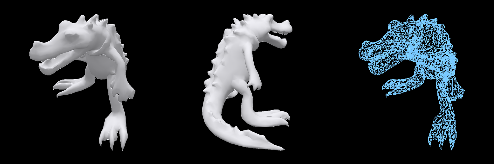
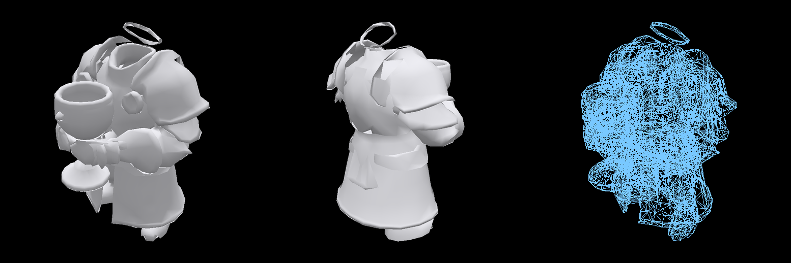

# ComfyUI-LATO2

ComfyUI nodes for [LATO.2](https://github.com/LoHhhha/LATO.2) ("Factorized 3D Mesh Generation with Vertex and Topology Flow"):
V-Flow generates vertex positions at a **controllable vertex count (200–5000)**, T-Flow predicts their **connectivity**.
The result is a clean, artist-style low/mid-poly mesh, not a marching-cubes soup. In a Trellis2 / Pixal3D / Hunyuan3D
pipeline, it turns their dense output into usable game-ready topology that sits in the same place as the source,
so you can bake the high-poly detail and texture onto it.

**No CUDA builds.** Upstream needs spconv, flash-attn, torch-scatter, o_voxel (CuMesh/FlexGEMM), nvdiffrast and open3d.
This pack vendors the model code (`vendor/lato2_vendor`, MIT) and swaps all of them for pure PyTorch:

| upstream dependency | replacement here |
|---|---|
| spconv `SubMConv3d` | gather + GEMM submanifold conv (`conv_torch.py`), same weight layout, checked against dense `conv3d`; reproduces spconv's 1×1×1 quirk (it reads `[Co,1,1,1,Ci]` as `[Ci,Co]`), which the checkpoints were trained through |
| flash-attn varlen | `torch.nn.functional.scaled_dot_product_attention` with padded/masked batches |
| torch-scatter | `scatter_add` fallback (only the training-time encoder uses it) |
| o_voxel `mesh_to_flexible_dual_grid` | exact triangle/box (SAT) surface voxelizer |
| open3d white-model render | ray-cast clay render on ComfyUI's own BVH (same camera/framing; lighting approximated) |
| torch.hub DINOv2 (code pulled from GitHub) | `transformers` `facebook/dinov2-with-registers-large` (safetensors) |

Checkpoints load with `torch.load(weights_only=True)`, so pickle code execution is not possible.

## Nodes (category `3d/LATO2`)

| node | what it does |
|---|---|
| **LATO2 Load Model** | Loads all networks from `models/lato2`; downloads missing weights on first use. `offload_after_run` hands VRAM back to other models between stages. |
| **LATO2 Mesh To Scaffold** | Any `MESH` → 64³ active-voxel scaffold + the clay conditioning render (`cond_render`). This is upstream's mesh→mesh path. |
| **LATO2 Voxel To Scaffold** | Takes a `VOXEL` from **Trellis2 VAE Decode Structure** (resolution 64) and skips the Trellis2 shape stages entirely. Needs an image on Generate. |
| **LATO2 Image To Scaffold (TRELLIS SS)** | Upstream's image→mesh stage 0: TRELLIS v1 sparse-structure flow from one image (+ optional foreground mask). |
| **LATO2 Scaffold Preview Mesh** | Scaffold as blocky cubes, to check voxelization and orientation (`LATO2ScaffoldPreviewMesh`). |
| **LATO2 Generate Mesh** | V-Flow → V-VAE → T-Flow → T-VAE → faces. Outputs `MESH`, the conditioning image actually used, and an info string. |

### Typical wirings

```
Trellis2 / Pixal3D / Hunyuan3D … → [MESH] → LATO2 Mesh To Scaffold → LATO2 Generate Mesh → Save 3D Model
                                                                 ↑
                                     LATO2 Load Model ───────────┘   (optional: image + mask → Generate)

Trellis2 VAE Decode Structure (64) → [VOXEL] → LATO2 Voxel To Scaffold → LATO2 Generate Mesh (image + mask required)

Load Image (+ background removal mask) → LATO2 Image To Scaffold → LATO2 Generate Mesh
```

**Example workflow:** `example_workflows/LATO2_mesh_to_mesh.json` (also listed under the pack in ComfyUI's
template browser): Load 3D → Get 3D Components → LATO2 Mesh To Scaffold → LATO2 Generate Mesh → Save 3D Model.
Copy `example_workflows/lato2_example_crocodile.glb` to `ComfyUI/input/3d/` (or pick your own model in Load 3D).
To use it after Trellis2, connect the `mesh` output of **Trellis2 VAE Decode Shape** to LATO2 Mesh To Scaffold instead.

**Which conditioning image?** Generate uses the `image` input if you connect one, otherwise the scaffold's own image
(the clay render for mesh scaffolds, the crop for image scaffolds). Clay renders match how the mesh→mesh model was
conditioned; your original reference image often carries more intent (upstream's image path uses real images). Try both.

**Lining up with the source:** with `restore_scale` on (default), mesh-scaffold results are mapped back to the input
mesh's bounding box, so the LATO2 mesh overlays the Trellis2 high-poly for **Bake Texture From Voxel / Bake Normal Map /
UV Unwrap** etc.

### Parameters worth knowing

- `vertex_count`: the main dial. Trained range 200–5000; the T-Flow refuses more than its `max_vertices`.
- `seed`: topology varies a lot between seeds; when a result has holes, a second seed usually beats tuning.
- `fill_open_rings` / `max_ring_size`: post-process that triangulates small holes (upstream default on, 12).
- `fix_normals`: LATO.2 faces come unoriented; this makes the winding consistent and outward (trimesh).
- `vflow_steps 24`, `vflow_cfg 3.0`, `tflow_steps 50`: upstream defaults.

## Models

Put in `ComfyUI/models/lato2/` (auto-downloaded when `auto_download` is on):

```
models/lato2/
  vflow.pt vvae.pt offset_head.pt tflow.pt tvae.pt voxel_encoder.pt    # huggingface.co/0x4c48/LATO.2 (~3.4 GB)
  dinov2-with-registers-large/{config.json,model.safetensors}         # facebook/dinov2-with-registers-large (~1.2 GB)
  trellis/ckpts/ss_flow_img_dit_L_16l8_fp16.* ss_dec_conv3d_16l8_fp16.* # microsoft/TRELLIS-image-large, only for Image To Scaffold
```

VRAM: ~3.2 GB peak measured (upstream quotes ~8 GB); weights live in system RAM between runs when `offload_after_run` is on.




## Verification (RTX 4090, torch 2.13 / CUDA 13, Python 3.13)

- Sparse conv vs dense `conv3d`: max error 7.6e-6; varlen SDPA vs per-sequence reference: 7e-7.
- V-VAE encode→decode on the bundled crocodile: vertex-voxel recall 100% at 64³, 99.8% at 128³, 99.3% at 256³;
  level-1 occupancy AUC 1.0. (Before the 1×1×1 quirk was reproduced: AUC 0.49, i.e. random sub-voxel placement.)
- Mesh→mesh crocodile, 2000-vertex target: 2201 vertices / 4398 faces, watertight, generated vertices median
  2.0/1024 from the source surface; ~9 s, 3.2 GB peak VRAM.
- Image→mesh (TRELLIS SS) on the bundled knight image: ~24 s end to end.

## Limitations

- Upstream's own warning applies: generated meshes may still have holes or wrong connectivity. Run **Fill Holes** /
  **Weld Vertices** afterwards, or re-seed.
- Output is capped at ~5000 vertices: LATO.2 is a topology/low-poly generator, not a detail generator. Keep the
  Trellis2 mesh for baking detail.
- The clay render is an approximation of upstream's Filament lighting; framing and camera are identical.
- One mesh per run (batch inputs use the first item).

## Install

```
cd ComfyUI/custom_nodes
git clone https://github.com/Tr1dae/ComfyUI-LATO2.git
```

Restart ComfyUI. Dependencies (trimesh, transformers, huggingface_hub) ship with ComfyUI portable; otherwise
`pip install -r requirements.txt`. Weights download on first run of **LATO2 Load Model**.
Needs a recent ComfyUI with the native `MESH` / `VOXEL` types (Trellis2 support).

## Credits / license

This pack: MIT (`LICENSE`). LATO.2 © its authors, MIT (see `vendor/lato2_vendor/LICENSE-LATO2`; vendored commit in `UPSTREAM_COMMIT`).
Builds on TRELLIS / TRELLIS.2 (MIT) and TripoSF. DINOv2 weights: Apache-2.0.
